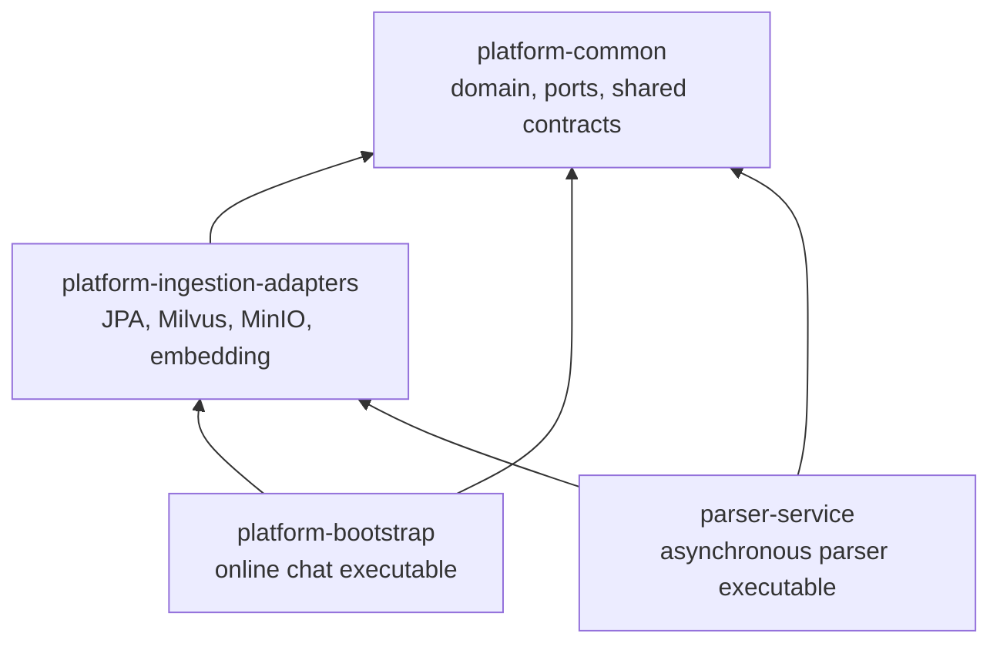

# NFR Production Hardening

> Branch: `experiment/nfr-production-hardening`  
> Scope: production configuration, dependency boundaries, chat-path consistency, and merge gates.  
> This document records code and test evidence; it does not claim unmeasured production capacity.

## 1. Why this change exists

The previous structure had four concrete risks:

1. Production configuration could silently inherit unsafe development defaults.
2. The web authentication filter depended directly on persistence details.
3. `parser-service` depended on the executable chat bootstrap module to reuse adapters.
4. `ChatService` owned conversation memory, context budgeting, citation verification, trace
   persistence, synchronous execution, and SSE execution in one class, making path drift likely.

The goal is not to introduce more services. The goal is to make existing deployment units explicit,
enforce dependency direction, and put duplicated business rules behind one implementation.

## 2. Resulting module boundary



`platform-bootstrap` and `parser-service` do not depend on each other. Module classpath tests and
Parser ArchUnit rules guard this property.

## 3. Chat execution responsibilities

`ChatService` remains the synchronous/SSE use-case orchestrator. The following cohesive policies
have one implementation each:

| Component | Responsibility |
| --- | --- |
| `ConversationContextCoordinator` | Load memory, detect topic shift, derive retrieval query, build history block |
| `ConversationHistoryWriter` | Persist successful turns and trigger best-effort compression |
| `ChatContextAssembler` | LITM reorder, token/character budget, context/citation alignment |
| `CitationVerificationCoordinator` | Verification, score annotation, WARN/REFUSE policy |
| `ChatResultFinalizer` | Query hashing, trace persistence, result construction, total-latency outcome |

The refactor intentionally stops at these boundaries. LLM execution and top-level orchestration
remain visible in `ChatService`; reducing line count alone is not a reason for further extraction.

## 4. Behavioral invariants

- Missing knowledge base returns `EMPTY_KB` without retrieval or LLM execution.
- Empty retrieval returns `NO_RECALL` without LLM execution.
- LLM failure returns `LLM_DEGRADED`; it does not write conversation history.
- Only `OK` turns enter conversation memory.
- Synchronous and SSE paths use the same effective retrieval query and context assembler.
- Context budget truncation removes citations that were not visible to the LLM.
- SSE emits exactly one terminal `DoneEvent`.
- Citation verification currently supports `WARN_ONLY` and `REFUSE`.
- `REGENERATE` is intentionally rejected at startup because regeneration is not implemented.

## 5. Verification evidence

Local verification executed on the branch after each cohesive change:

```text
./gradlew spotlessApply test --no-daemon
./gradlew :platform-bootstrap:bootJar :parser-service:bootJar --no-daemon
```

Dedicated gates include:

- production configuration tests;
- authentication fail-closed tests;
- Parser architecture and executable-classpath isolation tests;
- citation verification policy tests;
- context/citation alignment tests;
- conversation context and history tests;
- SSE single-terminal tests;
- synchronous/SSE terminal parity tests.

GitHub Actions and Testcontainers results must be taken from the pull request. Local success must
not be reported as remote CI success.

## 6. Configuration changes

- Production authentication cannot fall back to the development principal.
- Production parser mode is asynchronous.
- Agentic planning remains disabled by default.
- Citation verification `REGENERATE` is not an accepted runtime policy. Use `REFUSE` or
  `WARN_ONLY`.

No database schema migration is introduced by this hardening branch. The parse message remains
wire-compatible; its Java ownership moves to the shared contract module.

## 7. Deployment and rollback

Recommended rollout:

1. Build both executable jars from the same commit.
2. Deploy `platform-bootstrap` and `parser-service` to a non-production environment.
3. Run smoke tests for upload, parse completion, synchronous chat, and SSE chat.
4. Confirm no old parser instance depends on a removed message class before rolling chat instances.
5. Roll Parser workers first only when the shared message contract is confirmed compatible;
   otherwise deploy both within the same maintenance window.

Rollback is code-only because this branch has no schema migration:

1. restore both executable artifacts to the previous known-good commit;
2. restore the previous configuration set;
3. verify pending parse tasks remain in MySQL/RocketMQ;
4. rebuild Milvus-derived data only if an independent indexing failure occurred.

Do not roll back by deleting parse tasks, chunks, or vector collections.

## 8. Claims and remaining gates

Allowed claims after local verification:

- module boundaries are enforced by build and architecture tests;
- synchronous and SSE terminal semantics have contract coverage;
- production configuration has regression tests;
- both executable jars build locally.

Claims that remain forbidden until environment evidence exists:

- GitHub CI is green for this branch;
- a specific QPS, P95, P99, or TTFT target is met;
- all external dependency failures recover within an SLO;
- the system is enterprise-grade or production-proven at scale.

Remaining execution gates are tracked in this order:

1. Pull request CI and Testcontainers.
2. Automated tenant-isolation security tests.
3. Fault injection for Parser/MQ/storage/model dependencies.
4. Synthetic performance baseline.
5. Alert-to-runbook observability validation.
6. Rolling deployment and rollback drill.
7. Dependency, image, secret, and SBOM checks.

